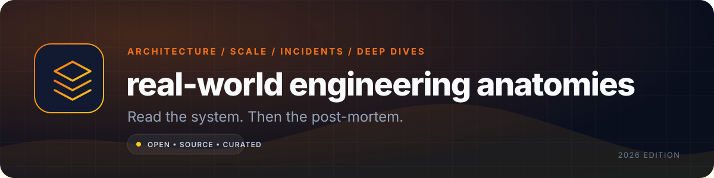

  

<h1 align="center">real-world engineering anatomies</h1>

  <strong>The best first-party engineering deep dives, architecture write-ups, and incident reports — organised by the system they explain.</strong> 
  Not tutorials. Not listicles. The primary sources behind software that had to work at scale.

  <a href="#how-to-read-an-anatomy">How to read</a> •
  <a href="#foundations">Foundations</a> •
  <a href="#systems-at-scale">Systems</a> •
  <a href="#security-reliability-and-post-mortems">Incidents</a> •
  <a href="#indie-and-small-team-anatomies">Indie</a> •
  <a href="CONTRIBUTING.md">Contribute</a>

  
  
  

> **A system-design diagram is a claim. An engineering write-up is the evidence.** This repository indexes the moments when a team explains the constraint, the decision, the trade-off, and what broke. Read the post-mortem after the architecture; the failure is often the most honest part of the design.

## How to read an anatomy

For each source, ask:

1. **What was the constraint?** Latency, cost, team size, compliance, or an existing system they could not replace.
2. **What was the decision?** A database, a protocol, a queue, a consistency model, a sharding key.
3. **What did it buy?** Throughput, simplicity, local-first UX, cost, or operational headroom.
4. **What did it cost?** Complexity, coupling, migration risk, on-call burden, or a new failure mode.
5. **What would they change?** The best write-ups say this explicitly. The second-best ones accidentally reveal it in the post-mortem.

**Reading order for a new topic:** one foundational paper → one company anatomy → one incident report → one source-code or documentation page. That gives you the theory, the implementation, the failure, and the current truth.

## Foundations

| Source | System | Read it for | Type |
|---|---|---|---|
| [Dynamo: Amazon's Highly Available Key-value Store](https://www.allthingsdistributed.com/files/amazon-dynamo-sosp2007.pdf) | DynamoDB lineage | Consistent hashing, vector clocks, eventual consistency, and the cost of always-write. | Paper |
| [The Google File System](https://research.google/pubs/pub51/) | Colossus lineage | Chunked storage, replication, and assumptions that shaped modern distributed storage. | Paper |
| [MapReduce](https://research.google/pubs/pub62/) | Batch processing | Data locality, shuffle, fault tolerance, and why "just use a bigger machine" has limits. | Paper |
| [Bigtable](https://research.google/pubs/pub27898/) | Spanner/HBase lineage | Sparse column families, tablets, and the original wide-column model. | Paper |
| [Spanner](https://research.google/pubs/pub39966/) | Globally consistent SQL | TrueTime, external consistency, and the real cost of global transactions. | Paper |
| [Raft](https://raft.github.io/raft.pdf) | etcd, Consul, CockroachDB | Understandable consensus: leader election, log replication, and membership changes. | Paper |
| [Kafka: a Distributed Messaging System](https://notes.stephenholiday.com/Kafka.pdf) | Kafka | Partitioned logs, consumer groups, and the durability/throughput trade-off. | Paper |
| [FoundationDB](https://www.foundationdb.org/files/fdb-paper.pdf) | FoundationDB | Deterministic simulation testing and a layered transactional core. | Paper |
| [Dapper](https://research.google/pubs/pub36356/) | Distributed tracing | Trace context propagation, sampling, and low-overhead observability. | Paper |
| [Borg](https://research.google/pubs/pub43438/) | Kubernetes lineage | Cluster scheduling, declarative desired state, and workload isolation. | Paper |
| [A comprehensive study of CRDTs](https://hal.inria.fr/inria-00555588/document) | Local-first collaboration | Convergent replicated data types and the mathematical basis for offline merge. | Paper |
| [The Twelve-Factor App](https://12factor.net/) | Cloud-native operations | Config, stateless processes, logs, and deployment discipline. | Manifesto |

## Systems at scale

| Source | System | Read it for | Type |
|---|---|---|---|
| [How Figma's multiplayer technology works](https://www.figma.com/blog/how-figmas-multiplayer-technology-works/) | Figma | WebSocket fan-out, conflict resolution, and why a central server beats full P2P. | First-party |
| [Rendering Figma](https://www.figma.com/blog/figma-rendering-powered-by-webgpu/) | Figma | Canvas rendering, incremental redraw, and performance under complex documents. | First-party |
| [How Discord stores trillions of messages](https://discord.com/blog/how-discord-stores-trillions-of-messages) | Discord | Cassandra → ScyllaDB migration, access patterns, and operational reality. | First-party |
| [How Discord scaled Elixir to 5M concurrent users](https://discord.com/blog/how-discord-scaled-elixir-to-5-000-000-concurrent-users) | Discord | BEAM scheduling, large-scale realtime, and language-level trade-offs. | First-party |
| [Deconstructing the monolith](https://shopify.engineering/deconstructing-monolith-designing-software-maximizes-developer-productivity) | Shopify | Modular monolith boundaries, developer productivity, and why microservices are not a default. | First-party |
| [Scaling Prime Video's audio/video monitoring by 90% cost reduction](https://www.primevideotech.com/video-streaming/scaling-up-the-prime-video-audio-video-monitoring-service-and-reducing-costs-by-90) | Prime Video | A monolith that beat a distributed design on cost and scale. | First-party |
| [The technology behind GitHub's new code search](https://github.blog/2023-02-06-the-technology-behind-githubs-new-code-search/) | GitHub | Trigram indexes, sharding, and search over billions of files. | First-party |
| [Partitioning GitHub's relational databases](https://github.blog/2021-09-27-partitioning-githubs-relational-databases-scale/) | GitHub | Horizontal sharding of MySQL without breaking developer workflows. | First-party |
| [Stack Overflow: the architecture](https://stackoverflow.blog/2016/02/17/stack-overflow-the-architecture-2016-edition/) | Stack Overflow | Vertical scaling, caching, and a deliberately boring stack. | First-party |
| [Scaling Slack's architecture](https://slack.engineering/slacks-migration-to-a-cellular-architecture/) | Slack | Cell-based architecture, failure isolation, and migration strategy. | First-party |
| [Netflix Tech Blog](https://netflixtechblog.com/) | Netflix | Streaming, experimentation, resilience, and data infrastructure at scale. | Archive |
| [H3: Uber's hexagonal hierarchical geospatial index](https://h3geo.org/) | Uber | Geospatial indexing, hexagons, and the cost of location queries. | First-party |
| [Stripe API versioning](https://stripe.com/blog/api-versioning) | Stripe | Backward compatibility as a product feature and an engineering constraint. | First-party |
| [How Cloudflare works](https://developers.cloudflare.com/fundamentals/concepts/how-cloudflare-works/) | Cloudflare | Anycast, edge termination, and the reverse-proxy model. | Docs |

## Frontend, collaboration, and local-first

| Source | System | Read it for | Type |
|---|---|---|---|
| [How browsers work](https://web.dev/articles/howbrowserswork) | Browser engines | Parsing, layout, paint, and the critical rendering path. | Explainer |
| [React Fiber architecture](https://github.com/acdlite/react-fiber-architecture) | React | Incremental rendering, prioritisation, and why rendering is interruptible. | Source-adjacent |
| [Fast properties in V8](https://v8.dev/blog/fast-properties) | V8 | Hidden classes, inline caches, and JavaScript object shape. | First-party |
| [What's different about Google Docs collaboration](https://drive.googleblog.com/2010/09/whats-different-about-new-google-docs.html) | Google Docs | Operational transforms, conflict resolution, and realtime text editing. | First-party |
| [Scaling the Linear sync engine](https://linear.app/blog/scaling-the-linear-sync-engine) | Linear | Local-first data, sync protocol design, and incremental updates. | First-party |
| [The data model behind Notion](https://www.notion.com/blog/data-model-behind-notion) | Notion | Block trees, relational data, and flexible schemas. | First-party |
| [React Server Components](https://react.dev/reference/rsc/server-components) | React | Server/client boundaries and the new rendering model. | Docs |
| [Rendering performance](https://web.dev/articles/rendering-performance) | Web platform | Frame budgets, layout thrashing, and paint costs. | Explainer |
| [WebAssembly concepts](https://developer.mozilla.org/en-US/docs/WebAssembly/Guides/Concepts) | WebAssembly | Modules, memory, and the browser's sandboxed binary format. | Docs |
| [Content-visibility](https://web.dev/articles/content-visibility) | Browser rendering | Skipping off-screen work and its layout trade-offs. | Explainer |

## Data, storage, and consistency

| Source | System | Read it for | Type |
|---|---|---|---|
| [PostgreSQL MVCC](https://www.postgresql.org/docs/current/mvcc.html) | PostgreSQL | Transaction isolation, snapshots, and vacuum. | Docs |
| [SQLite testing](https://www.sqlite.org/testing.html) | SQLite | How a tiny team tests a database to an extreme level. | First-party |
| [Redis persistence](https://redis.io/docs/latest/operate/oss_and_stack/management/persistence/) | Redis | RDB vs AOF, fsync trade-offs, and durability limits. | Docs |
| [Amazon Aurora](https://www.amazon.science/publications/amazon-aurora-design-considerations-for-high-throughput-cloud-native-relational-databases) | Aurora | Log-structured storage and separating compute from durability. | Paper |
| [Snowflake: SIGMOD paper](https://www.cs.cmu.edu/~15721-f24/papers/Snowflake.pdf) | Snowflake | Multi-cluster warehouses and storage/compute separation. | Paper |
| [How Notion shards Postgres](https://www.notion.com/blog/sharding-postgres-at-notion) | Notion | Logical sharding, tenant placement, and online migration. | First-party |
| [How Figma handles 2 billion writes per day](https://www.figma.com/blog/how-figmas-databases-team-lived-to-tell-the-scale/) | Figma | Vertical partitioning and operating Postgres at high write volume. | First-party |
| [DuckDB: an embeddable analytical database](https://duckdb.org/why_duckdb) | DuckDB | Why columnar, in-process analytics can replace a warehouse for many jobs. | Docs |
| [FoundationDB simulation testing](https://apple.github.io/foundationdb/testing.html) | FoundationDB | Deterministic simulation and the value of testing failures, not just features. | First-party |
| [Designing data-intensive applications](https://dataintensive.net/) | Distributed data | The vocabulary of replication, partitioning, transactions, and consistency. | Book |

## Realtime, messaging, and media

| Source | System | Read it for | Type |
|---|---|---|---|
| [Discord voice architecture](https://discord.com/blog/how-discord-handles-a-million-concurrent-voice-users) | Discord | Voice SFUs, regional routing, and realtime media at scale. | First-party |
| [WebRTC overview](https://webrtc.org/getting-started/overview) | WebRTC | Signaling, ICE, DTLS-SRTP, and peer-to-peer media. | Docs |
| [Cloudflare Durable Objects](https://developers.cloudflare.com/durable-objects/) | Durable Objects | Coordination, single-point serialization, and stateful edge workloads. | Docs |
| [The infrastructure behind Twitter's scale](https://blog.twitter.com/engineering/en_us/topics/infrastructure/2017/the-infrastructure-behind-twitter-scale) | Twitter | Fan-out, timelines, and the read/write asymmetry of social feeds. | First-party |
| [Netflix Open Connect](https://openconnect.netflix.com/en/) | Netflix | CDN appliance design, peering, and video delivery economics. | First-party |
| [Cloudflare Stream](https://developers.cloudflare.com/stream/) | Cloudflare Stream | Video ingest, transcoding, and delivery as an edge product. | Docs |
| [How Mux approaches video encoding](https://www.mux.com/articles/video-encoding-for-streaming-developers-guide) | Mux | Encoding ladders, codecs, and the quality/bitrate trade-off. | First-party |
| [LiveKit Agents](https://docs.livekit.io/agents/) | LiveKit | Realtime voice agents, WebRTC transport, and turn detection. | Docs |
| [Scaling Pub/Sub](https://cloud.google.com/blog/products/application-development/how-google-cloud-pubsub-works) | Google Pub/Sub | At-least-once delivery, ordering, and queue design. | First-party |

## Security, reliability, and post-mortems

| Source | System | Read it for | Type |
|---|---|---|---|
| [GitLab database incident post-mortem](https://about.gitlab.com/blog/postmortem-of-database-outage-of-january-31/) | GitLab | Backup assumptions, replication, and a painfully honest recovery. | Post-mortem |
| [GitHub network partition post-mortem](https://github.blog/news-insights/company-news/oct21-post-incident-analysis/) | GitHub | Split-brain, MySQL failover, and the cost of a 43-second event. | Post-mortem |
| [Cloudflare 2019 regex outage](https://blog.cloudflare.com/details-of-the-cloudflare-outage-on-july-2-2019/) | Cloudflare | A WAF rule, catastrophic regex backtracking, and blast-radius design. | Post-mortem |
| [AWS S3 2017 outage](https://aws.amazon.com/message/41926/) | S3 | A command error, index subsystem restart, and recovery at scale. | Post-mortem |
| [AWS Kinesis 2020 outage](https://aws.amazon.com/message/11201/) | Kinesis | Thread limits, fleet health, and cascading dependency failure. | Post-mortem |
| [Facebook 2021 outage](https://engineering.fb.com/2021/10/05/networking-traffic/outage-details/) | Facebook | BGP withdrawal, DNS collapse, and out-of-band recovery. | Post-mortem |
| [Roblox 2021 outage](https://corp.roblox.com/newsroom/2022/01/roblox-return-to-service-10-28-10-31-2021) | Roblox | Cascading internal service failure and recovery sequencing. | Post-mortem |
| [CircleCI 2023 incident report](https://circleci.com/blog/jan-4-2023-incident-report/) | CircleCI | Key compromise, token rotation, and customer trust. | Incident report |
| [Datadog 2023 incident](https://www.datadoghq.com/blog/engineering/2023-03-08-deep-dive-into-incident-response/) | Datadog | Global outage, dependency isolation, and recovery. | Post-mortem |
| [CrowdStrike 2024 root cause analysis](https://www.crowdstrike.com/wp-content/uploads/2024/08/Channel-File-291-Incident-Root-Cause-Analysis-08.06.2024.pdf) | CrowdStrike | Content validation, staged rollout, and kernel-level risk. | RCA |
| [Cloudflare 2025 service outage](https://blog.cloudflare.com/cloudflare-service-outage-june-12-2025/) | Cloudflare | Configuration failure, global impact, and operational lessons. | Post-mortem |
| [xz backdoor disclosure](https://www.openwall.com/lists/oss-security/2024/03/29/4) | xz-utils | Supply-chain attack, maintainer trust, and build-system isolation. | Disclosure |

## Indie and small-team anatomies

These are not miniature versions of hyperscale systems. They are different constraint sets: one founder, no on-call rota, and a requirement to stay profitable.

| Source | System | Read it for | Type |
|---|---|---|---|
| [Pieter Levels: minimal solo-founder setup](https://levels.io/minimal-solo-founder-100-automation) | Nomad List / Remote OK | A deliberately small stack, automation, and solo operation. | First-party |
| [Nomad List open data](https://nomadlist.com/open) | Nomad List | Transparency, community data, and a small-team product surface. | First-party |
| [Baremetrics open startup](https://baremetrics.com/open-startups) | Baremetrics | Public revenue metrics and the economics of a bootstrapped SaaS. | First-party |
| [Basecamp Shape Up](https://basecamp.com/shapeup) | Basecamp | Fixed time, variable scope, and shipping without a backlog death spiral. | Book |
| [Indie Hackers interviews](https://www.indiehackers.com/) | Various | Distribution, pricing, and the unglamorous work of getting customers. | Interviews |
| [MicroConf talks](https://microconf.com/) | Various | Bootstrapped SaaS strategy, pricing, and founder-led sales. | Talks |
| [Ghost: independent publishing](https://ghost.org/blog/) | Ghost | A small team building a sustainable open-source product. | First-party |
| [Plausible: privacy-first analytics](https://plausible.io/blog) | Plausible | A focused product, transparent pricing, and a simpler data model. | First-party |

## Primary archives

| Archive | What it is for | Start with |
|---|---|---|
| [High Scalability](http://highscalability.com/) | Classic architecture case studies and “how X scales” write-ups. | Search the system you are studying. |
| [The Architecture of Open Source Applications](https://aosabook.org/en/) | Source-level architecture of real open-source systems. | The chapter on a tool you use daily. |
| [ACM Queue](https://queue.acm.org/) | Practitioner-written systems articles with unusual depth. | The distributed systems and storage sections. |
| [Netflix Tech Blog](https://netflixtechblog.com/) | Streaming, experimentation, resilience, and data platform engineering. | The architecture and reliability tags. |
| [Stripe Engineering](https://stripe.com/blog/engineering) | API design, payments infrastructure, and reliability. | Idempotency and API versioning. |
| [Cloudflare Blog](https://blog.cloudflare.com/) | Edge networking, DDoS, protocols, and excellent incident write-ups. | The post-mortem archive. |
| [GitHub Engineering](https://github.blog/engineering/) | Developer tooling, search, databases, and CI at scale. | Code search and MySQL posts. |
| [InfoQ Architecture](https://www.infoq.com/architecture-design/) | Conference talks and practitioner interviews. | The case-study track. |
| [System Design Primer](https://github.com/donnemartin/system-design-primer) | A structured vocabulary and interview-oriented overview. | Use it before the primary sources, not instead of them. |
| [Papers We Love](https://paperswelove.org/) | A community index of foundational computer-science papers. | The distributed systems shelf. |

## What makes a source worth including

- It is **first-party** or a peer-reviewed paper, not a content farm summary.
- It names the **constraint** and the **trade-off**, not just the winning technology.
- It includes a **diagram, schema, metric, or failure timeline** that can be checked.
- It is still reachable, or clearly marked as historical.
- It does not pretend a hyperscale decision applies unchanged to a five-person team.

## Contributing

Suggest a deep dive using [CONTRIBUTING.md](CONTRIBUTING.md). Include the original URL, the system, and one sentence about the decision it explains. Reposts, SEO rewrites, and paywalled summaries are not accepted.

## License

Original index text is released under the [MIT License](LICENSE). Linked articles, papers, diagrams, and trademarks remain the property of their authors.

---

**Last reviewed: 2026-11-03.** Prices, metrics, licences, and availability change; verify against the linked upstream source before relying on them.
